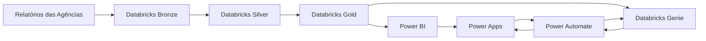

# ✈️ Dashboard de Viagens Corporativas

Projeto de portfólio voltado à análise de viagens corporativas, com **tratamento de dados no Databricks**, arquitetura **Bronze / Silver / Gold**, consumo no **Power BI** e um **Assistente de Viagens com Databricks Genie**, integrado por **Power Apps + Power Automate**.

> **Observação:** este projeto utiliza dados fictícios/sanitizados para fins de estudo, demonstração técnica e portfólio.

---

## 📌 Objetivo

Construir uma solução capaz de:

- receber relatórios de viagens de diferentes agências;
- padronizar dados com layouts distintos;
- tratar passagens, hospedagens, Uber e diárias;
- consolidar os dados em uma camada analítica;
- disponibilizar indicadores no Power BI;
- classificar justificativas com regras + LLM + revisão humana;
- permitir perguntas em linguagem natural usando Databricks Genie;
- respeitar o contexto de filtros aplicados no Power BI;
- manter continuidade de conversa no assistente.

---

## 🧱 Arquitetura



### Fluxo resumido

```text
Arquivos brutos
    ↓
Bronze
    ↓
Silver
    ↓
Gold
    ├── Power BI
    └── Databricks Genie
            ↑
Power Apps ← Power Automate
```

A camada **Gold** é o principal ponto de consumo do projeto. Ela foi estruturada para alimentar tanto o Power BI quanto o Genie, evitando concentrar regras de tratamento na camada visual.

---

## 🛠️ Tecnologias

- Databricks
- PySpark
- Spark SQL
- Delta Lake
- SQL
- Power BI
- Power Query
- DAX
- Power Apps
- Power Automate
- Databricks Genie
- Git / GitHub

---

## 📂 Organização dos notebooks

```text
01_setup_ambiente
02_silver_passagens
03_silver_hospedagens
04_silver_uber
05_silver_auxiliares
06_gold_viagens
07_gold_passagens
08_gold_hospedagens
09_gold_uber
10_gold_diarias
11_gold_auditoria_ia
```

Mais detalhes em [`docs/databricks.md`](docs/databricks.md).

---

## 🥉 Bronze

Camada de entrada dos arquivos brutos.

Exemplo:

```text
/Volumes/viagens_teste/bronze/arquivos/
```

---

## 🥈 Silver

Responsável por:

- padronização de colunas;
- conversão de datas;
- limpeza de valores monetários;
- identificação de agência;
- tratamento de centro de custo;
- campos derivados;
- classificação e tratamento de justificativas.

Principais tabelas:

```text
silver.passagens
silver.hospedagens
silver.uber
silver.diarias
silver.cancelados
silver.nao_voados
silver.regras_justificativas
silver.classificacao_llm_passagens
silver.classificacao_llm_dupla_passagens
silver.revisao_humana_justificativas
```

---

## 🥇 Gold

### Fatos

```text
gold.fato_viagens
gold.fato_passagens
gold.fato_hospedagens
gold.fato_uber
gold.fato_diarias
```

### Dimensões

```text
gold.dim_agencia
gold.dim_centro_custo
gold.dim_data
gold.dim_tipo_despesa
gold.dim_trimestre
```

### Auditoria

```text
gold.auditoria_justificativas
```

### Volumes da base demonstrativa

| Estrutura | Registros |
|---|---:|
| Passagens | 36 |
| Hospedagens | 24 |
| Uber | 30 |
| Diárias | 20 |
| Fato consolidado | 110 |

---

## 🧠 Classificação de justificativas

O processo utiliza **regras + LLM + revisão humana**.

### Tipo de atividade

- Reunião
- Visita / Vistoria
- Capacitação
- Evento
- Acompanhamento
- Apoio Presencial
- Outros

### Tema

- Contratos / Fornecedores
- Financeiro / Controles
- Tecnologia / Projetos
- Jurídico
- Pessoas
- Comunicação / Institucional
- Auditoria / Fiscalização
- Outros

> Esta etapa **não é apresentada como Machine Learning treinado**.

Resultados da base demonstrativa:

| Indicador | Resultado |
|---|---:|
| Registros auditados | 36 |
| Concordância Tipo | 91,7% |
| Concordância Tema | 91,7% |
| Revisões Humanas | 6 |

---

## 📊 Power BI

### Páginas

1. Visão Geral
2. Passagens e Justificativas
3. Hospedagem
4. Uber e Diárias
5. Diretoria e Centro de Custo
6. Auditoria, Qualidade e IA

### Organização das medidas

```text
00_Medidas
01_passagens
02_Medidas_Hospedagens
03_Medidas_Uber
04_Medidas_Diarias
05_Medidas_Justificativas
06_Medidas_Diretoria_CC
07_Medidas_Auditoria_IA
```

Essa separação facilita manutenção, leitura e evolução do modelo.

Mais detalhes em [`docs/powerbi.md`](docs/powerbi.md).

---

## 🤖 Assistente de Viagens

```text
Power BI
   ↓
Power Apps
   ↓
Power Automate
   ↓
Databricks Genie API
   ↓
Gold
```

Funcionalidades:

- perguntas em linguagem natural;
- continuidade de conversa via `conversation_id`;
- uso do contexto de filtros do Power BI;
- retorno da resposta no próprio relatório;
- avatar do assistente;
- imagem da conta logada do usuário.

Exemplo:

```text
Usuário:
Quanto foi gasto com passagens?

Assistente:
R$ 64.664,95.

Usuário:
E por diretoria?

Assistente:
mantém o contexto da conversa e detalha por diretoria.
```

Mais detalhes em [`docs/assistant-genie.md`](docs/assistant-genie.md).

---

## 🎛️ Contexto dos filtros

```text
Contexto Ano
Contexto Mês
Contexto Trimestre
Contexto Diretoria
Contexto Centro de Custo
Contexto Agência
```

Exemplo:

```text
Ano: 2026
Diretoria: DIRPES
Agência: Todos

Pergunta:
Quanto foi gasto com passagens?
```

---

## 📈 Indicadores principais

```text
Valor total: R$ 110.400,17
Passagens: R$ 64.664,95
Hospedagens: R$ 28.452,52
Diárias: R$ 14.409,26
Uber: R$ 2.873,44
```

---

## 🧭 Boas práticas aplicadas

- separação por camadas;
- consumo orientado à Gold;
- fatos e dimensões separados;
- relacionamento 1:N;
- filtro dimensão → fato;
- evitar relacionamento fato → fato;
- medidas organizadas por domínio;
- tratamento de dados fora da camada visual;
- documentação do fluxo;
- dados fictícios/sanitizados para portfólio.

---

## 📸 Screenshots

Sugestão:

```text
docs/images/
├── 01-visao-geral.png
├── 02-passagens.png
├── 03-hospedagem.png
├── 04-uber-diarias.png
├── 05-diretoria-centro-custo.png
├── 06-auditoria-ia.png
├── 07-assistente-genie.png
├── 08-databricks-notebooks.png
├── 09-databricks-catalog.png
└── 10-powerbi-medidas.png
```

Uso no README:

```md

```

---

## 🔐 Segurança

Não versionar:

- tokens;
- PATs;
- credenciais;
- segredos;
- dados pessoais;
- informações corporativas confidenciais;
- endpoints privados.

---

## 📁 Estrutura sugerida

```text
viagens-corporativas/
│
├── README.md
├── notebooks/
├── powerbi/
├── docs/
│   ├── architecture.md
│   ├── databricks.md
│   ├── powerbi.md
│   ├── assistant-genie.md
│   └── images/
└── data/
```

---

## 🚀 Próximas evoluções

- ingestão automatizada;
- Databricks Jobs / Workflows;
- Auto Loader;
- integração com SharePoint ou repositório de entrada;
- autenticação via OAuth / Service Principal;
- monitoramento;
- testes automatizados;
- CI/CD.

---

## ⚠️ Disclaimer

Este projeto utiliza dados fictícios/sanitizados. Nomes, valores, agências, viajantes e demais registros não devem ser interpretados como dados operacionais reais de qualquer organização.

---

## 👨‍💻 Foco do projeto

**Engenharia de Dados • Business Intelligence • Analytics • Automação • IA aplicada a dados**
