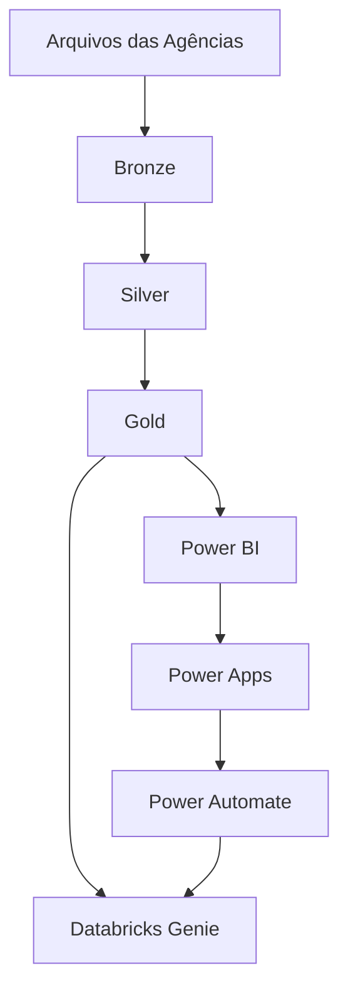

# Arquitetura

## Visão geral

## Bronze
Preserva os arquivos de entrada com transformação mínima.

## Silver
Centraliza padronização, limpeza, regras e enriquecimento.

## Gold
Disponibiliza fatos, dimensões e auditoria prontos para consumo.

## Princípio principal
A lógica estrutural fica no Databricks; o Power BI atua como camada analítica.
